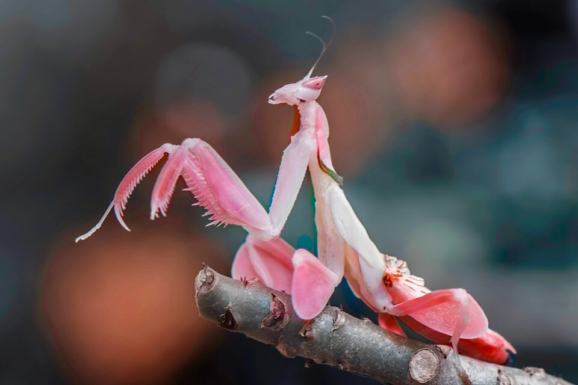

Лабораторная работа №1\
Бойко Александр Владимирович, 6405-010302D\
Научный руководитель: Головашкин Д.Л.\
"Исследование гибридных разностных методов решения уравнений Максвелла"\
Cercavo amore e alla fine mi ero illusa fossi te\
\

# Лабораторная работа №2

**Тема:** "Богомолы".

Многостраничный сайт на HTML и CSS.

## Страницы:

- Главная
- Виды
- Галерея
- Содержание
- Выставки

## Технологии: 

- HTML5
- CSS3

Без JavaScript и сторонних библиотек.

Проект находится в папке [lab2](./lab2/).

# Лабораторная работа №3

**Тема:** Основы JavaScript.

Набор функций на JavaScript, реализованных в рамках каркаса проекта.

## Что сделано
- Реализованы функции согласно заданию.
- Использованы разные типы данных, операторы, функции, массивы, объекты.
- Проверка работы через автотесты (Mocha / npm test).

## Ссылки
- [Проект в папке `lab3`](./lab3/)

# Лабораторная работа №4

**Тема:** Modern CSS + OOP in JS.

Модернизация сайта из lab2 с использованием Flexbox, Grid, CSS-переменных, анимаций и класса на JavaScript.

## Что сделано

- `lab4/index.html` — вёрстка главной через **Flexbox** (шапка, hero, карточки, футер).
- `lab4/gallery.html` — вёрстка галереи через **CSS Grid** (`auto-fit`, `span`).
- `lab4/form.html` — форма регистрации с 7 типами полей.
- Все цвета вынесены в **CSS-переменные** (`:root`), в правилах используются только `var(--...)`.
- Реализованы **анимации:** анимированный градиент hero, «парящий» маскот, scroll-reveal через `IntersectionObserver`, zoom + overlay в галерее, shake при ошибке формы.
- **ООП:** класс `FormSubmission` с приватными полями `#fields`, `#timestamp`, методами `format()` и `print()`. На сабмите форма создаёт объект и вызывает `print()` — в консоли появляется таблица.
- Соблюдена методология **БЭМ**.

## Технологии

- HTML5
- CSS3 (Flexbox, Grid, CSS Custom Properties, Animations, `IntersectionObserver`)
- JavaScript (ES2022: classes, private fields, modules)
- БЭМ

## Ссылки

Проект в папке [lab4](./lab4/).

